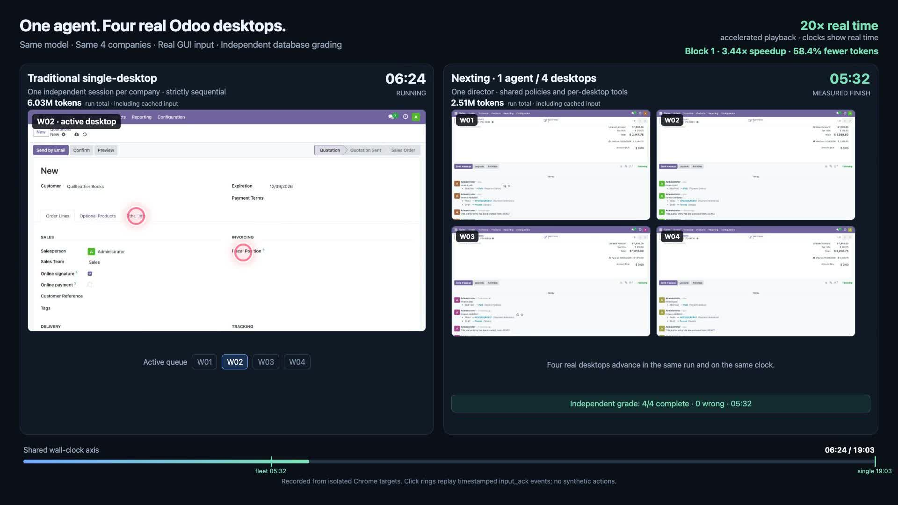
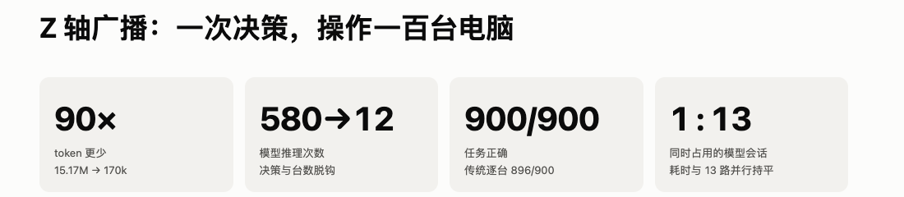
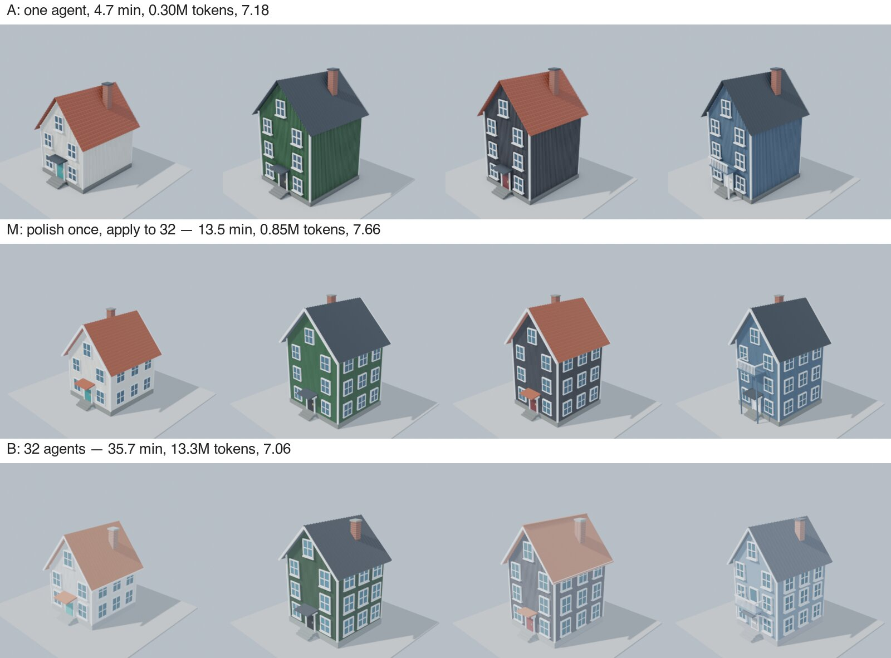
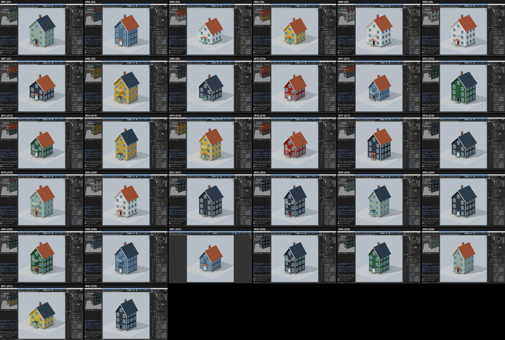

<div align="center">

# Multi-Computer Use

**Infra that lets one agent operate many computers at once.**

An open-source execution and verification layer for Computer Use fleets.<br>
Share repeated decisions, inject per-device values, contain exceptions, and check the result on each machine.

By [Nexting AI](https://nexting.ai) · [Apache-2.0](LICENSE) · [Real GUI, measured results](docs/validation/)

**[Watch the 60-second demo](docs/assets/e13/odoo-single-vs-four.mp4)** · **[Read the evidence](#real-results)** · **[Quickstart](#quickstart)**

</div>

## What is it?

Multi-Computer Use gives one AI agent many desktops to work on, so it can complete repetitive tasks in parallel and verify the result on each one.

It is **not another agent model or a generic harness**. It is the multi-device execution and verification layer that sits below your existing agent:

- **Share decisions:** describe a repeated GUI procedure once instead of re-deriving it per desktop.
- **Keep device-specific values:** customer names, order references, quantities, and other inputs come from each device's task row, not from the model's transcription.
- **Contain variation:** a canary runs first; devices that do not match are left untouched and grouped for a different policy or individual attention.
- **Verify delivery:** check post-conditions on every device, review the fleet in one image, and independently grade the resulting business records.
- **Protect against duplicates:** every input is journaled before delivery; an input with an unknown outcome is never blindly replayed.

Bring your own agent and model. Use local, isolated Chrome targets or Linux desktops reachable through Docker over SSH. The current project is an open-source research harness, not a hosted service or a consumer remote-control app.

## Results at a glance

| Measured workload                         |       Wall-time improvement |              Token improvement |                   Independently verified result |
| ----------------------------------------- | --------------------------: | -----------------------------: | ----------------------------------------------: |
| **Odoo order-to-cash, 4 desktops**        | **70.9% less time (3.44×)** |         **58.4% fewer tokens** | **4/4 companies on both arms, 0 wrong records** |
| **Back office, 100 desktops**             |                  Same 312 s |  **98.9% fewer tokens (~90×)** |                    **900/900 vs 896/900 items** |
| **House variations, fleet vs 32 agents**  |  **62.2% less time (2.6×)** | **93.6% fewer tokens (15.7×)** |    **96/96 checks; blind quality 7.66 vs 7.09** |
| **Excalidraw, 12 cursors + text handoff** |  **60.1% less time (2.5×)** |          **22.2% more tokens** |                   **9/9 diagrams on both arms** |

**Press-ready summary:** In a matched Odoo order-to-cash comparison, one agent completed four companies in **5 minutes 32 seconds**, against **19 minutes 4 seconds** for sequential single-desktop Computer Use—**70.9% less wall time**, **58.4% fewer tokens**, and **60.3% fewer tool calls**, with **4/4 companies independently verified on both**. In a separate 100-desktop back-office task, the runtime used **0.17M tokens against 15.17M**—**about 90× fewer tokens, a 98.9% reduction**—while completing **900/900 items**, against 896/900 for 13 parallel per-machine agents. Against 32 independent Blender agents, one agent building 32 house variations used **93.6% fewer tokens** and finished **62.2% sooner**, with a higher blind quality score.

These are measured results with baselines and limitations, not universal multipliers or dollar-cost estimates. The second Odoo pair is excluded from the speed percentage because its baseline stopped at the token budget with W04 incomplete. The 100-desktop result is a token result, not a 90× speed claim. **[Evidence and exact reports](#real-results)**

---

## See it working: real order-to-cash on four Odoo desktops

[](docs/assets/e13/odoo-single-vs-four.mp4)

**[Watch the 60-second comparison](docs/assets/e13/odoo-single-vs-four.mp4)** — real GUI recordings and timestamped click events, not a recreated interface. Playback is accelerated; the clocks show measured wall time.

One agent completes four companies' **order → delivery → posted invoice → reconciled full payment** workflows. The baseline uses independent same-model, single-desktop sessions, strictly one at a time.

| Block 1, seed 13013                  | Single-desktop baseline | One agent, four desktops |       Difference |
| ------------------------------------ | ----------------------: | -----------------------: | ---------------: |
| Wall time                            |                   19:04 |                 **5:32** | **3.44× faster** |
| Model tokens, including cached input |                   6.03M |                **2.51M** |  **58.4% fewer** |
| Tool calls                           |                     189 |                   **75** |  **60.3% fewer** |
| Independently verified companies     |                     4/4 |                  **4/4** | Same correctness |
| Wrong records                        |                       0 |                    **0** |             Same |

**A second fresh-seed pair also completed 4/4 on the fleet, in 8:11 with 3.45M tokens.** The single-desktop baseline reached 3/4 in 15:06 and stopped at its 6M token budget; W04 had a draft invoice and no payment. Its observed time is therefore **not a same-completion speed measurement**.

The fleet used one director in block 1 and one director plus one continuation in block 2, with no per-desktop helper agents. The baseline used five and four independent sessions respectively. Two pairs are evidence of a real effect on this workload, not a universal speed or dollar-cost multiplier.

**[Full E13 report](docs/validation/2026-11-08-e13-odoo.md)** · **[Preregistration](docs/validation/2026-11-08-preregistration-e13.md)** · **[Summary data](docs/validation/data/2026-11-08-e13-summary.json)**

## Choose your path

- **Integrate your agent:** read [How it works](#how-it-works), then run the [local evaluation](#quickstart).
- **Evaluate a workload:** run the 22 deterministic fault scenarios, or start from the [preregistered runner](lab/virtual-screen/eval-run.ts) and [existing workloads](lab/workloads/).
- **Review the evidence:** compare real time, tokens, correctness, and the negative results below. Every linked report describes what actually ran, including limits and failed hypotheses.

## Real results

Unless noted otherwise, experiments used `gpt-6-astra` (medium). Token counts include cached input and are not a direct dollar-cost estimate. Time and tokens are reported separately; older serial-baseline speed claims are not reused.

### 100 desktops: about 90× fewer tokens, not 90× faster

Three items were filed on each of 100 independent back-office desktops, repeated in three blocks. The baseline was conventional per-machine Computer Use with **13 agents in parallel**. Grading read the server's business records.

|                | Fleet runtime | Per-machine, 13 in parallel |
| -------------- | ------------: | --------------------------: |
| Model tokens   |     **0.17M** |                      15.17M |
| Model sessions |         **1** |                          13 |
| Correct items  |   **900/900** |                     896/900 |
| Wall time      |         312 s |                       312 s |

The shared procedure used about **90× fewer tokens** with slightly higher correctness. Wall time was effectively tied; the earlier **34× speed** number came from a serial baseline and has been retracted. The bottleneck after broadcasting is the GUI work itself, not another model call per machine.

With 20 layouts, the fleet used 0.69M tokens against 5–7M for per-machine operation. With 100 all-different layouts, the token advantage disappeared, but correctness did not drop. Machine-read values matter: when the model transcribed 100 values from images instead, 8.4% were wrong.

[](docs/showcase/z-broadcast.html)

_Static preview of the Z-axis principle and results page. [Open the HTML for charts and source data](docs/showcase/z-broadcast.html)._

**[Fair parallel-baseline report](docs/validation/2026-10-31-e1p-parallel-baseline.md)** · **[Strict evaluation and ablations](docs/validation/2026-10-30-strict-evaluation.md)** · **[Results page](docs/showcase/z-broadcast.html)**

### 32 desktops: one design, 32 house variations

The agent polished one parametric Blender design on desktop 1, applied it to 32 desktops with per-plot parameters, and reviewed all 32 renders in one overview. The comparison is 32 independent agents, each re-deriving the design.

|                                | One agent, one desktop | **Fleet: 1 agent, 32 desktops** | 32 agents, 32 desktops |
| ------------------------------ | ---------------------: | ------------------------------: | ---------------------: |
| Blind quality, 1–10            |                   6.99 |                        **7.66** |                   7.09 |
| Wall time                      |            **4.7 min** |                        13.5 min |               35.7 min |
| Model tokens                   |              **0.30M** |                           0.85M |                 13.31M |
| Screenshots sent to the model  |                      6 |                              13 |                    252 |
| Built, on plot, correct height |                  96/96 |                           96/96 |                  96/96 |

Against 32 independent agents, the fleet used **15.7× fewer tokens** and finished **2.6× sooner**, with a higher blind quality score. A single agent looping one script was faster and cheaper still, but produced plainer houses. More desktops pay off when each item takes real GUI work or needs its own application state—not automatically.



**[S3 report](docs/validation/2026-11-04-s3-street.md)** · **Films:** [fleet](docs/assets/s3/M-harness.mp4), [32 agents](docs/assets/s3/B-32-agents.mp4), [one agent](docs/assets/s3/A-one-agent.mp4)

### Multi-cursor work: speed and token cost are different trade-offs

In 36 repeated Excalidraw runs, one agent using 12 cursors plus a text-state handoff completed **9/9** diagrams and reached 100% in a median **87 seconds**, against **218 seconds** for one cursor—about **2.5× faster**. It also used **1.22× the tokens**, so this is a speed result, not a token-saving result.

The text handoff reduced median finisher time from **103 to 28 seconds** and finisher tokens by **72%**. Pure multi-cursor and the older picture handoff each completed only 7/9. The older picture handoff reached 100% sooner at 73 seconds, so the preregistered H1 did **not** pass; it then spent much longer checking.

**[E11 report](docs/validation/2026-11-08-e11.md)** · **[E10 report, 27 runs](docs/validation/2026-11-07-e10.md)**

## Where it works—and where it does not

**A good fit:**

- Repeated GUI workflows across companies, accounts, stores, or desktops
- The same procedure with different values per device
- Slow legacy software with no useful API
- Work that needs both shared decisions and independent verification
- Exceptions that can be isolated for a separate policy or individual repair

**A poor fit:**

- One-off creative work where every item needs different judgement
- A task that a direct API or a short script on one desktop already handles better
- Arbitrary, entirely different layouts where no stable decision can be shared
- A generic agent that has not first demonstrated the single-desktop workflow

These boundaries are measured, not hypothetical:

- **Sixteen different buildings:** independent per-building agents scored 8.13 against 4.88 for one director. A shared director used fewer tokens but produced plainer work. [S1 report](docs/validation/2026-11-03-s1-city-block.md)
- **Parallel refiners:** faster than independent agents but used more tokens (6.98M vs 4.32M). [S2 report](docs/validation/2026-11-03-s2-refiners.md)
- **Rainforest airport:** one agent per piece was fastest and best; three desktops per agent cost 4× the tokens and delivered only 14 of 16 pieces. [S4 report](docs/validation/2026-11-04-s4-airport.md)
- **Unseen MiniWoB++:** three rounds scored 581, 507, and 560 of 600, against 600 for per-machine operation. This is not a claim of universal web competence. [Held-out evaluation](docs/validation/2026-10-30-strict-evaluation.md)

## How it works

Ordinary Computer Use repeats the full perception and reasoning loop per computer. This runtime treats the fleet as another axis—**Z**, like a batch dimension.

1. **Observe an exemplar.** The agent selects a stable template, variable fields, actions, and a post-condition.
2. **Run a canary.** The policy runs on one device before it can reach the others. A rejected canary leaves the rest untouched.
3. **Execute per device.** The runtime registers the template locally, reads device-specific values through accessibility text or OCR, checks each target, and applies the inputs independently.
4. **Collect evidence, not assumptions.** Each device returns a delivery receipt and post-condition. Uncertain outcomes are resolved from evidence rather than replayed.
5. **Review and repair together.** The agent sees one tiled fleet overview, handles exception groups or individual outliers, and can independently grade the final application records.

[](docs/assets/s3/m-fleet-overview.jpg)

_One actual fleet overview: 32 desktops reviewed in one image, rather than 32 separate model inspections._

```text
task table + exemplar → one agent policy → canary → per-device runners
                                                   ├─ value injection
                                                   ├─ target binding
                                                   ├─ durable input journal
                                                   └─ post-condition
                              → fleet overview → exceptions → independent grade
```

The agent can also use per-desktop tools where a shared policy is the wrong abstraction. That is the intended split: **shared work where possible, individual attention where necessary.**

## Quickstart

Requirements: Node ≥ 24, pnpm, and Google Chrome (`CU_CHROME` overrides the macOS default path).

```sh
pnpm install
pnpm check          # typecheck + unit tests
pnpm fault-suite    # 22 deterministic fault scenarios in real Chrome, no model
```

For a small model evaluation on local Chrome surfaces, point [`examples/local-eval.json`](examples/local-eval.json) at your Codex CLI and authorization file, then run:

```sh
node --import tsx lab/virtual-screen/eval-run.ts examples/local-eval.json
```

The example compares conventional per-surface operation with broadcast execution. Desktop applications such as Blender and KiCad run in Linux containers; see [`packages/desktop`](packages/desktop/) and the workload reports for their host configuration.

**Use isolated desktops and browser profiles, not your daily environment.** Model authorization stays local; it is not archived in evaluation plans. Production credential handling and fleet provisioning remain your responsibility.

The Odoo examples use synthetic companies and disposable `admin/admin` and `odoo/odoo` credentials only inside isolated test environments. They are not real user accounts or secrets; never reuse those defaults in a deployed environment.

**Provisioning is destructive to the test fleet:** it resets and removes containers labeled `e5` on the configured Docker host. Use a dedicated local VM or isolated Docker context, never a shared or production host.

## Repository layout

| Path                                     | Responsibility                                                 |
| ---------------------------------------- | -------------------------------------------------------------- |
| `packages/virtual-screen/src/stack.ts`   | Policies, canary, per-device pipeline, binding, and overview   |
| `packages/virtual-screen/src/cdp.ts`     | Chrome frames, input, accessibility text, and input journal    |
| `packages/virtual-screen/src/workset.ts` | Durable progress and disjoint per-device worksets              |
| `packages/desktop/`                      | Linux desktop surfaces, container images, and fleet launcher   |
| `lab/virtual-screen/`                    | Preregistered runner, arms, analysis, and fault suite          |
| `lab/workloads/`                         | Web forms, Odoo, MiniWoB++, Blender, KiCad, and evidence tools |
| `docs/validation/`                       | Preregistrations, reports, and machine-readable results        |
| `docs/assets/`                           | Real comparison films and images                               |

## License

[Apache-2.0](LICENSE). Vendored MiniWoB++ files retain their MIT license.

Issues and reproducibility questions: [GitHub Issues](https://github.com/Nexting-ai/multi-computer-use/issues).
