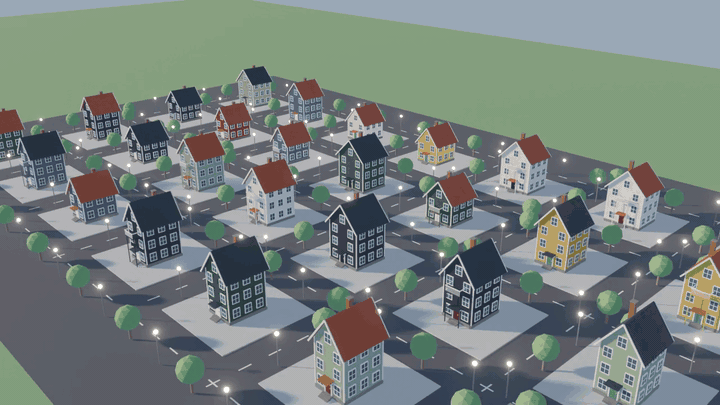

# multi-computer-use

**One agent, many computers.** A harness that lets one Computer Use agent operate many desktops at once. The agent decides once, the runtime applies that decision to every machine, and the agent checks all of them in one look.

By [Nexting AI](https://nexting.ai).



## Cases

Every case was preregistered before it ran and is reported as measured, failures included. Unless noted, the model is `gpt-6-astra` (medium). Each case links its full report.

### 1. A street of 32 houses in Blender

One house design, 32 variations: width, floors, colours, roof and balcony differ per plot. All three arms are agents working through the Blender screen (interface and Blender's Python), each house on its own plot.

| | One agent, one desktop | **The harness: 1 agent, 32 desktops** | 32 agents, 32 desktops |
|---|---:|---:|---:|
| Blind quality (1–10) | 6.99 | **7.66** | 7.09 |
| Wall time | **4.7 min** | 13.5 min | 35.7 min |
| Model tokens | **0.30M** | 0.85M | 13.31M |
| Screenshots sent to the model | 6 | 13 | 252 |
| Built, on plot, right height | 96/96 | 96/96 | 96/96 |


How the harness ran it:
1. The agent polished the design once on desktop 1.
2. It applied the design to all 32 desktops as one policy, each desktop with its own parameters.
3. It reviewed the 32 renders in [one overview image](docs/assets/s3/m-fleet-overview.jpg).

Against 32 independent agents it used **6.4% of the tokens** and took 2.6× less time, and its houses scored higher. The independent agents each re-derived the design and drifted. A single agent looping one script was fastest, but built plainer houses.

[Report](docs/validation/2026-11-04-s3-street.md) · films: [harness](docs/assets/s3/M-harness.mp4), [32 agents](docs/assets/s3/B-32-agents.mp4), [one agent](docs/assets/s3/A-one-agent.mp4)

### 2. The same back office on 100 desktops

Three items to file in a business back office, on each of 100 desktops, run three times. The baseline is conventional per-machine Computer Use, 13 agents in parallel. Grading reads the server's records.

| | The harness | Per-machine, 13 in parallel |
|---|---:|---:|
| Model tokens | **0.17M** | 15.17M (~90× more) |
| Model sessions | **1** | 13 |
| Items correct | **900/900** | 896/900 |
| Wall time | 312 s | 312 s |

- **Model calls stop growing with the number of machines.** 300 items took 12 inferences, against 580 for the per-machine baseline.
- **Values are read, not transcribed.** Each machine's values come from a text channel. When the model transcribed 100 values from images instead, 8.4% were wrong.
- **Different layouts cost about one decision each.** With 20 layouts the harness used 0.69M tokens, against 5–7M for per-machine operation. With 100 all-different layouts the advantage disappears, but correctness does not drop.
- **Second model:** Claude Sonnet 5.5 showed the same ~100× saving at identical correctness.

[Report](docs/validation/2026-10-31-e1p-parallel-baseline.md) · [results page](docs/showcase/z-broadcast.html)

### 3. Sixteen different buildings: where it does not save tokens

A city block of 16 buildings that all differ: a pagoda, a glass tower, a lighthouse. When the director wrote one generic script for all sixteen, it was cheap but plain, scoring about 4.5 of 10. Sixteen agents, one per building, scored 8.0.

A director with sixteen parallel refiners reached 7.4 in under half the time (24.7 vs 54.5 min), but used *more* tokens (6.98M vs 4.32M). When every item needs its own decisions, each one costs an agent's attention whichever way the work is organised. The harness pays off where items share a decision, as in cases 1 and 2.

[S1 report](docs/validation/2026-11-03-s1-city-block.md) · [S2 report](docs/validation/2026-11-03-s2-refiners.md)

### 4. Safe under faults

The fault suite has 22 deterministic scenarios in real Chrome, each run with its safeguard on and off. With the safeguards on, there were zero misrouted inputs and zero duplicates:
- a wrong policy is contained by the canary;
- an input with a lost reply is closed only from evidence;
- moved controls, reordered labels and occluded buttons are caught;
- unbound clicks are refused before any input.

### Not yet: arbitrary websites

On unseen MiniWoB++ tasks, three preregistered rounds scored 581, 507 and 560 of 600, against 600 for per-machine operation. All four error mechanisms now have fixes under test. The held-out round [F3](docs/validation/2026-10-31-preregistration-f3.md) has not run yet.

## How it works

Ordinary Computer Use runs one screenshot→think→click loop per computer. This harness treats the set of computers as a third axis (Z), like a batch dimension:

1. **The agent looks at one example screen and writes a policy:**
   - the stable template;
   - the fields that differ per machine;
   - the steps, including typing per-machine text such as `{floors}`;
   - the post-condition that proves success.
2. **The runtime applies the policy to every machine independently.** On each one it:
   - registers the template;
   - reads that machine's values from a text channel (accessibility tree, or OCR on desktops);
   - checks that each click lands on the intended element;
   - executes, then verifies the post-condition on that machine.
3. **A canary runs first.** Machines that do not match are left untouched and grouped by appearance.
4. **The agent reviews the results** in one tiled overview and fixes what differs, by another policy or on a single desktop.

Every input is written to a durable ledger before it is sent. An input whose outcome is uncertain is never replayed.

## Try it

You need Node ≥ 24, pnpm and Google Chrome (`CU_CHROME` if not at the macOS default path).

```sh
pnpm install
pnpm check          # typecheck + unit tests
pnpm fault-suite    # 22 fault-injection scenarios in headless Chrome (~15 min, no model)
```

For a small model evaluation on local Chrome surfaces, point [`examples/local-eval.json`](examples/local-eval.json) at your Codex CLI and run:

```sh
node --import tsx lab/virtual-screen/eval-run.ts examples/local-eval.json
```

Desktop apps (Blender, KiCad) run in Linux containers (`packages/desktop`). Build an image with `docker build -f packages/desktop/image/Dockerfile --build-arg APP=blender packages/desktop`, then list your Docker hosts in the workload config.

## Layout

| Path | What |
|---|---|
| `packages/virtual-screen/src/stack.ts` | The runtime: policies, canary, per-machine pipeline, binding, overview |
| `packages/virtual-screen/src/cdp.ts` | Chrome surfaces: frames, input, accessibility text |
| `packages/desktop/` | Linux desktop surfaces: container image, agent (frames, OCR, input), fleet launcher, Blender and KiCad apps |
| `lab/virtual-screen/` | Preregistered runner, arms, analysis, fault suite |
| `lab/workloads/` | Workloads (web forms, MiniWoB++, Blender, KiCad), blind judge, films |
| `docs/validation/` | Preregistrations, reports and raw data |

## License

Apache-2.0. The vendored MiniWoB++ files keep their MIT license.
