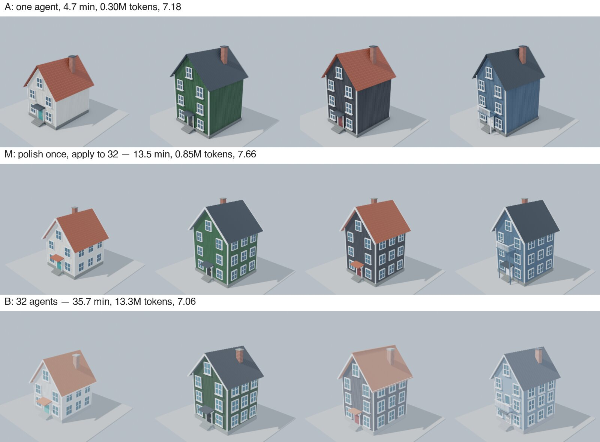

# S3: a street of 32 variations — results (2026-11-04)

Preregistration: [2026-11-04-preregistration-s3.md](2026-11-04-preregistration-s3.md).

- **Runs:** commit `9a1c4ff` for A, and `b280be4` for M and B. `b280be4` only raises the schema's cap on parallel per-surface sessions from 16 to 32, which arm B needs.
- **Setup:** seed 9301 (street seed 957407077), `gpt-6-astra` medium, one attempt per arm, no failed or excluded runs. 32 desktops over 8 directly reachable servers; A on its own server.
- **Judging:** blind, comparative, one plot at a time (Claude Sonnet), on standard photos rendered from the saved files.
- **Data:** [`data/2026-11-04-s3-summary.json`](data/2026-11-04-s3-summary.json), [`data/2026-11-04-s3-judge.json`](data/2026-11-04-s3-judge.json).

## Results

| | A: one agent, one desktop | **M: polish once, apply to 32** | B: 32 agents, 32 desktops |
|---|---:|---:|---:|
| Blind quality, overall (1–10) | 7.18 | **7.66** | 7.06 |
| brief / craft / materials / soundness | 7.2 / 6.4 / 6.7 / 8.3 | 7.8 / 7.5 / 7.1 / 8.2 | 6.8 / 7.1 / 6.4 / 8.0 |
| Wall time | 4.7 min | 13.5 min | 35.7 min |
| Tokens | 0.30M | **0.85M** | 13.31M |
| Tool calls | 41 | 23 | 409 |
| Screenshots sent to the model | 6 | 13 | 252 |
| Objective checks (built, on plot, height) | 96 / 96 | 96 / 96 | 96 / 96 |
| Declared done | 32 | 32 | 32 |

Plot by plot, M against B: 21 wins, 4 ties, 7 losses. M against A: 24 wins, 6 ties, 2 losses.

## Hypotheses

- **H8 (M ≥ B − 1.0): supported.** M scored 7.66 and B 7.06, so M beat B outright.
- **H9 (M tokens ≤ 20% of B): supported.** M used 6.4% of B's tokens (0.85M vs 13.31M), 15.7× fewer.
- **H10 (M wall time ≤ B): supported.** M took 13.5 min, B 35.7 min (2.6× faster).
- **A vs M (no threshold):**
  - A was the fastest and cheapest: one script looped over the 32 plots in 4.7 min and 0.30M tokens.
  - M scored higher (7.66 vs 7.18) and won 24 of 32 plots.
  - In the photos, A's houses have windows on the gable end only, while M's have them on every side.

## What M did

The whole director session had 23 tool calls:
1. **Polish once.** M wrote the house as one parametrised Blender script on W01, rendered it, and refined it while looking at W01 only.
2. **Apply to 32.** It sent the script to all 32 desktops in one `type` policy. Each desktop received its own row's parameters (width, floors, cladding, door, roof, balcony). The policy ran on one canary desktop first and verified every desktop afterwards.
   - Getting there took several policies. Four drafts were rejected by validation before running, mostly because their template or post-condition did not fit the screen. One canary attempt failed on W01.
   - The broadcast that ran went to W02–W32. On 26 desktops its on-screen post-condition was verified. On 5 it was not (`prepare_unverified`), but those houses were built: the objective checks pass 96/96.
3. **Review together.** M rendered all 32 previews in parallel and checked them in one `fleet_overview` image ([the image it saw](../assets/s3/m-fleet-overview.jpg)), then declared all 32 done.

Thirteen screenshots in total covered the polish on one house and the review of thirty-two.

## What this shows

- **The harness's intended case is real.** When the work is one design with many variations, the design decision is paid for once. Applying it, checking it and reviewing it scale to many desktops at almost no extra model cost. That cost was 6.4% of per-desktop agents, at higher quality and in 2.6× less time.
- **Polishing once beats repeating the polish 32 times.** B's 32 agents each re-derived the same design from scratch, and their results drifted: roof colours washed out and some details were missing. M's single polished design was applied the same way everywhere.
- **Compared with S1/S2:** buildings that all differ needed per-building attention (S2: no token saving). Variations of one design do not. The boundary is how much of the work is a shared decision.
- **Remaining limit:** for a script that runs this quickly, one desktop looping over all plots (A) is still faster. Many desktops pay off when each item is slow to produce, or when each item must be built and checked in its own application state.
