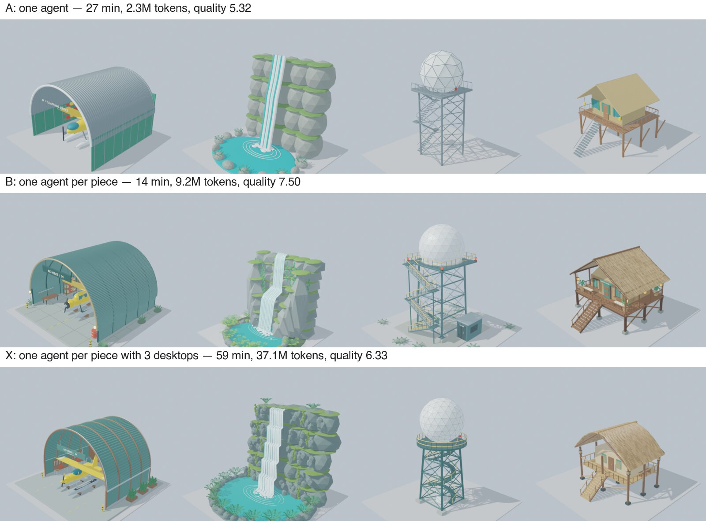

# S4: a rainforest airport — results (2026-11-04)

Preregistration: [2026-11-04-preregistration-s4.md](2026-11-04-preregistration-s4.md).

- **Runs:**
  - A at `b7fe1be`; X and B at `a3444e5`, B after X. The commits differ only in how tunnels are cleaned up and how local ports are checked.
  - Seed 9401 (piece seed 454649683), `gpt-6-astra` medium, one attempt per arm.
  - A first X attempt failed at launch before any model call: a stopped smoke run had left a tunnel holding local ports. It was fixed in `a3444e5` and is kept in `.local/s4/run-x-fail1`.
- **Judging:** blind and comparative, per piece, on equal-size standard photos (Claude Sonnet). A piece without a declared result is judged on an empty photo and scores 1.
- **Films:** [A](../assets/s4/A.mp4), [B](../assets/s4/B.mp4), [X](../assets/s4/X.mp4).
- **Data:** [`data/2026-11-04-s4-summary.json`](data/2026-11-04-s4-summary.json), [`data/2026-11-04-s4-judge.json`](data/2026-11-04-s4-judge.json), [`data/2026-11-04-s4-scene.json`](data/2026-11-04-s4-scene.json).

## Results

| | A: one agent | **B: one agent per piece** | X: one agent per piece, 3 desktops |
|---|---:|---:|---:|
| Blind quality per piece, overall | 5.32 | **7.50** | 6.33 |
| … on the 14 pieces X declared | 5.23 | **7.39** | 7.09 |
| brief / craft / materials / soundness | 5.5 / 4.7 / 4.9 / 6.1 | 7.5 / 7.6 / 7.3 / 7.6 | 6.4 / 6.4 / 5.9 / 6.7 |
| Whole-scene, overall (coherence / craft / richness) | 7.25 (7.8 / 6.5 / 8.0) | **7.50** (7.5 / 7.3 / 8.0) | 5.75 (6.5 / 6.5 / 5.8) |
| Wall time | 27.3 min | **13.7 min** | 59.2 min |
| Tokens | 2.35M | 9.22M | 37.09M |
| Tool calls | 58 | 282 | 623 |
| Pieces declared | 16 | 16 | 14 |
| Objective checks | 47/48 | 47/48 | 40/48 |

- **Plot by plot:** X beats B on 4 pieces, ties 1 and trails on 11. X beats A on 12 pieces, ties 1 and trails on 3.
- **Where X won:** the seaplane hangar, the waterfall cliff, the cable car station and the rescue helipad.
- **Where X did not deliver:** the rope bridge and the terminal pavilion. Their agents never declared a final version, through three sessions each.

## Hypotheses

- **H11 (X ≥ B + 0.5 per piece): not supported.** X scored 6.33 and B 7.50. On the 14 pieces X declared, X scored 7.09 and B 7.39.
- **H12 (X scene > B scene): not supported.** X scored 5.75 and B 7.50. X's two empty plots weigh on the whole scene.
- **H13 (X time ≤ 1.25 × B): not supported.** X took 59.2 min against 13.7 min for B (4.3×).
- **H14 (X ≥ A + 1.5 per piece): not supported.** X scored 6.33 and A 5.32, a margin of 1.0.
- **Tokens:** X used 4.0× B's tokens and 15.8× A's.

## What happened

**Each X agent spent much of its run on the fleet interface rather than the piece.** Across X's 623 tool calls:

| What went wrong | Count |
|---|---:|
| Desktop operations failed at run time (mostly capture timeouts) | 87 |
| Policies rejected as malformed (missing `fields`) | 34 |
| Policies with an expired exemplar view | 31 |
| Key-only policies, such as F12 for a render, which need a click first | 31 |
| Template mismatches, because desktops of one piece drifted apart (render windows, editors) | 36 |

B's 282 calls on per-desktop tools had no such errors.

**The servers were saturated.**
- Every server ran four desktops of 2 vCPU. When an X agent rendered three previews at once, the server's CPUs were full and screen captures timed out.
- The rope bridge's and the pavilion's agents could not compare their versions or confirm a save, so they never declared a final version.
- B uses the same density but renders one preview per agent at a time, so it never saturated.

**When it worked, trying three ideas at once did produce better pieces:**
- X won 4 of the 14 pieces it declared, often clearly, for example the waterfall (8.0 against 6.5) and the cable car (8.25 against 6.25).
- The 2-piece smoke run showed the same (8.75 against 7.38).
- Across the board, though, it did not beat a single agent that iterates quickly on one desktop.

## Conclusion

- **For sixteen different pieces, the best arm was the simplest:** one agent per piece, each on its own desktop, in parallel (B). It was the fastest and scored highest, at a quarter of X's tokens.
- **The harness, as it stands, costs more than it adds here.** Fleet policies (templates, fields, exemplar views, canaries) are built for screens that repeat. That is where S3 (one design, 32 variations) and the 100-desktop forms case gained. For free-form work on a few desktops each, those rules became overhead.
- **What would have to change before the idea is tested again:**
  - a light per-desktop "run this script" primitive for free tasks, with no template or fields;
  - one render at a time per server, or servers with spare CPU.

  These are engineering changes, not tested here.
- **The general result now holds across S1–S4.**
  - Many desktops under one decision win when the work repeats: forms, and variations of one design.
  - When every piece is different, independent agents in parallel remain the strongest baseline.
